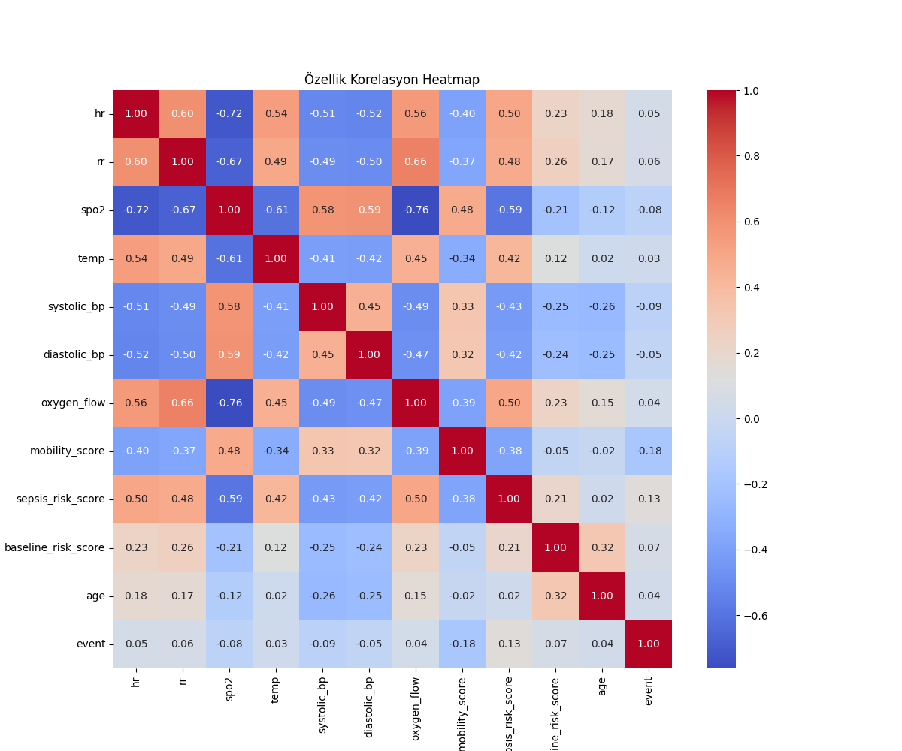
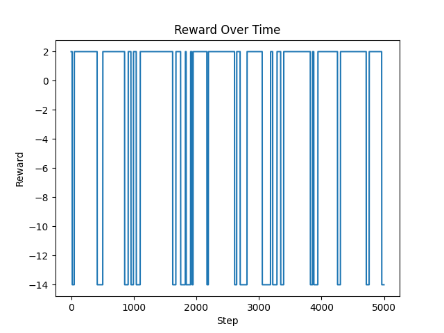

# Klinik Karar Destek Prototipi

**Pekiştirmeli öğrenme ile alarm politikası geliştirme, makine öğrenmesi ile risk tahmini ve klinik kurallarla erken uyarı üretme.**

Bu proje, hastaların vital bulgularını değerlendirerek önümüzdeki 12 saat içinde klinik kötüleşme riskini inceleyen bir klinik karar destek prototipidir. Python ile geliştirilen sistem; **Proximal Policy Optimization (PPO)** tabanlı pekiştirmeli öğrenme, **XGBoost** tabanlı sınıflandırma, klinik kural motoru ve **Streamlit** arayüzünü aynı proje yapısında bir araya getirir.

Projenin pekiştirmeli öğrenme bölümünde ajan, hasta gözlemlerine karşılık **alarm ver / alarm verme** aksiyonlarını seçerek bir alarm politikası öğrenir. Streamlit uygulaması ise XGBoost risk tahminlerini klinik kurallarla birlikte değerlendirerek etkileşimli bir erken uyarı paneli sunar.

## Projenin Amacı

- Vital bulgulardan klinik kötüleşme riskini modellemek.
- PPO ajanına ödül ve ceza mekanizmasıyla alarm verme davranışı kazandırmak.
- Kritik olayların yakalanması ile gereksiz alarmların azaltılmasını birlikte ele almak.
- Model çıktısını risk seviyeleri, klinik skorlar ve görsel analizlerle sunmak.
- Veri hazırlama, eğitim, değerlendirme ve tahmin kaydını modüler bir yapıda yürütmek.

## Teknik Mimari

~~~mermaid
flowchart TD
    A[Hasta gözlemleri ve 12 saatlik kötüleşme etiketi] --> B[Veri hazırlama ve standardizasyon]
    B --> C[Hasta bazında eğitim / test ayrımı]
    C --> D[Eğitim verisini dengeleme]
    D --> E[Gymnasium PatientEnv]
    E --> F[PPO ajan eğitimi]
    F --> G[Alarm politikası ve test grafikleri]
    D --> H[XGBoost eğitimi ve olasılık kalibrasyonu]
    H --> I[Kaydedilen modeller]
    J[Manuel giriş / hazır hasta senaryosu] --> K[StandardScaler ve temel XGBoost tahmini]
    I --> K
    K --> L[Klinik kural motoru]
    L --> M[Streamlit risk paneli ve klinik skorlar]
    L --> N[SQLite tahmin kayıtları]
~~~

PPO eğitim akışı, alarm kararlarını ödül maksimizasyonu üzerinden öğrenir. XGBoost eğitim akışı ise kötüleşme olasılığını tahmin eden modelleri oluşturur. Arayüzde temel XGBoost modelinin çıktısı ve kural motorunun değerlendirmesi kullanılır.

## Kullanılan Teknolojiler

| Teknoloji | Projedeki görevi |
| --- | --- |
| Python | Veri işleme, model eğitimi ve uygulama geliştirme |
| Gymnasium | Özel hasta ortamı, gözlem ve aksiyon uzayları |
| Stable-Baselines3 / PPO | Pekiştirmeli öğrenme ajanı ve politika optimizasyonu |
| XGBoost | Klinik kötüleşme olasılığının tahmini |
| scikit-learn | Standardizasyon, veri ayrımı, kalibrasyon ve metrikler |
| Pandas / NumPy | Tablosal veri ve sayısal hesaplamalar |
| Streamlit | Etkileşimli klinik dashboard |
| Plotly | Etkileşimli özellik önemi ve trend grafikleri |
| Matplotlib / Seaborn | Veri analizi ve değerlendirme görselleri |
| TensorBoard | Eğitim sürecini izleme |
| SQLite | Tahminlerin ve alarm gerekçelerinin kaydı |
| Joblib | Modelleri ve standardizasyon nesnesini saklama |
| SHAP | Ağaç tabanlı model için açıklanabilirlik yardımcı modülü |

## Veri Yapısı ve Ön İşleme

Model girdisi 11 sayısal özellikten oluşur:

| Kaynak sütun | Özellik | Açıklama |
| --- | --- | --- |
| heart_rate | hr | Nabız |
| spo2_pct | spo2 | Oksijen doygunluğu |
| respiratory_rate | rr | Solunum sayısı |
| temperature_c | temp | Vücut sıcaklığı |
| systolic_bp | systolic_bp | Sistolik kan basıncı |
| diastolic_bp | diastolic_bp | Diyastolik kan basıncı |
| oxygen_flow | oxygen_flow | Oksijen desteği akışı |
| mobility_score | mobility_score | Mobilite skoru |
| sepsis_risk_score | sepsis_risk_score | Sepsis risk skoru |
| baseline_risk_score | baseline_risk_score | Temel risk skoru |
| age | age | Yaş |

Hasta kimliği **patient_id**, gözlem zamanı **hour_from_admission**, hedef değişken ise **deterioration_next_12h** sütunuyla temsil edilir. Hedef değişken ön işleme sırasında **event** olarak adlandırılır: 0 kötüleşme yok, 1 kötüleşme var.

**src/prepare_real_data.py** şu işlemleri gerçekleştirir:

1. Gerekli sütunların seçilmesi ve isimlerinin düzenlenmesi.
2. Eksik gözlemlerin temizlenmesi.
3. Sınıf dağılımı ve özellik korelasyon grafiklerinin oluşturulması.
4. Özelliklerin StandardScaler ile standardize edilmesi.
5. Hasta kimlikleri üzerinden %80 eğitim ve %20 test ayrımı.
6. Eğitim kümesindeki azınlık sınıfının yeniden örneklemeyle dengelenmesi.
7. İşlenmiş veri kümeleri ve scaler dosyasının kaydedilmesi.

## Pekiştirmeli Öğrenme: PPO

### Ortam, Durum ve Aksiyon

**src/patient_env.py** içindeki PatientEnv sınıfı, Gymnasium arayüzünü kullanan özel bir ortamdır. Her bölümün başlangıcında bir hasta seçilir ve o hastaya ait kayıtlar üzerinde ilerlenir.

- **Durum / gözlem:** 11 özellik içeren float32 vektör.
- **Gözlem uzayı:** Box, boyut (11,).
- **Aksiyon uzayı:** Discrete(2).
- **Aksiyon 0:** Alarm verme.
- **Aksiyon 1:** Alarm ver.
- **Geri bildirim:** Seçilen aksiyon ile mevcut kaydın event etiketi karşılaştırılarak hesaplanan ödül.

Ajanın aldığı aksiyon alarm kararını temsil eder. Ortamın bir sonraki gözlemi veri kümesindeki sonraki kayıttan gelir.

### Ödül Tasarımı

| Karar sonucu | Ödül |
| --- | ---: |
| Doğru alarm — True Positive | +10 |
| Gereksiz alarm — False Positive | -5 |
| Kaçırılan kötüleşme — False Negative | -20 |
| Doğru sessizlik — True Negative | +2 |

Bu asimetrik ödül yapısı, kötüleşen hastaların tespitine daha yüksek ağırlık verirken alarm davranışını da düzenler. Ajan, indirgenmiş toplam ödülün beklenen değerini artıracak politikayı öğrenmeye çalışır:

~~~math
J(\pi) = \mathbb{E}_{\pi}\left[\sum_{t=0}^{T} \gamma^t r_t\right]
~~~

PPO, politika güncellemelerini kırpılmış bir amaç fonksiyonuyla sınırlandırarak eğitimde dengeli güncellemeler hedefler. Projede Stable-Baselines3 uygulaması ve MlpPolicy kullanılır.

### Eğitim Yapılandırması

| Parametre | Değer |
| --- | ---: |
| Algoritma | PPO |
| Politika | MlpPolicy |
| Öğrenme oranı | 0.00005 |
| Rollout adım sayısı | 2048 |
| Mini-batch boyutu | 64 |
| İndirgeme katsayısı — gamma | 0.99 |
| Hedef toplam eğitim adımı | 100000 |
| Ara model kayıt sıklığı | 10000 adım |
| Değerlendirme sıklığı | 5000 adım |

Monitor eğitim istatistiklerini takip eder. CheckpointCallback ara modelleri, EvalCallback değerlendirme sonuçlarını ve en iyi modeli kaydeder. StopTrainingOnNoModelImprovement, değerlendirme iyileşmesine göre erken durdurma sağlar. Eğitim çıktıları TensorBoard üzerinden izlenebilir.

**src/test_model.py**, kaydedilen PPO modelini test verisi üzerinde 100 bölüm boyunca değerlendirir; sınıflandırma raporu, karışıklık matrisi, ROC eğrisi ve ödül dağılımı üretir.

## XGBoost ile Risk Tahmini

**src/models/train_xgb.py**, dengelenmiş eğitim verisiyle XGBoost sınıflandırıcısını eğitir.

| Parametre | Değer |
| --- | ---: |
| Ağaç sayısı — n_estimators | 200 |
| Maksimum derinlik — max_depth | 5 |
| Öğrenme oranı | 0.05 |
| Satır örnekleme oranı — subsample | 0.8 |
| Özellik örnekleme oranı — colsample_bytree | 0.8 |
| Eğitim değerlendirme metriği | AUC |
| Rastgelelik tohumu | 42 |

CalibratedClassifierCV ile **3 katlı çapraz doğrulama ve isotonic regression** kullanılarak kalibre edilmiş bir model oluşturulur. Ayrıca temel XGBoost modeli ayrı olarak eğitilip kaydedilir.

- **xgb_calibrated.joblib:** Kalibre edilmiş model ve kayıtlı test metriklerinin kaynağı.
- **xgb_base.joblib:** Streamlit risk tahminleri ve özellik önemi analizinde kullanılan model.
- **scaler.joblib:** Eğitim ve arayüz girdilerinde kullanılan standardizasyon nesnesi.

## Klinik Kural Motoru

**src/rules/clinical_rules.py**, model olasılığını vital bulgularla birlikte değerlendirir. Arayüzde dört durum gösterilir:

| Seviye | Durum | Renk |
| --- | --- | --- |
| 0 | Stabil | Yeşil |
| 1 | Hafif risk | Sarı |
| 2 | Yüksek risk / yakın takip | Turuncu |
| 3 | Kritik alarm | Kırmızı |

Kritik alarm kuralları sistolik kan basıncı, oksijen doygunluğu, solunum sayısı, nabız ve sıcaklık için tanımlanan eşiklere dayanır. Kritik kural oluştuğunda alarm öncelik kazanır. Diğer durumlarda model olasılığı ve kullanıcının seçtiği karar eşiği risk seviyesini belirler.

Motor ayrıca erken sepsis, hipoksi ve şokla ilişkili vital bulgu örüntülerini inceler. NEWS2, qSOFA ve SIRS başlıkları altında, uygulamanın topladığı bileşenlerden skorlar hesaplanır: qSOFA için solunum ve sistolik basınç; SIRS için sıcaklık, nabız ve solunum; NEWS2 için solunum, SpO2, oksijen desteği, sistolik basınç, nabız ve sıcaklık kullanılır.

## Streamlit Arayüzü

### Klinik Dashboard

- 11 hasta özelliği için manuel veri girişi.
- Stabil hasta, erken sepsis, septik şok ve akut hipoksi senaryoları.
- Ayarlanabilir model karar eşiği.
- Risk olasılığı, renkli durum kartı ve alarm gerekçesi.
- Klinik skorlar ve bulgu örüntüsü analizi.
- Mevcut değerlerden üretilen 24 saatlik örnek trend simülasyonu.

### Açıklanabilir Yapay Zekâ

Temel XGBoost modelinin genel özellik önemleri yatay çubuk grafikle sunulur. Böylece modelin hangi değişkenlere daha fazla ağırlık verdiği incelenebilir. Proje ayrıca SHAP TreeExplainer ve waterfall grafiği üretimi için ayrı bir yardımcı modül içerir.

### Model Performansı ve Eğitim

Kalibre edilmiş XGBoost modelinin kayıtlı test metrikleri görüntülenir. Karar eşiği arayüzden ayarlanabilir ve risk seviyelerindeki değişim gözlenebilir. Kayıtlı metrikler eğitim betiğinin 0.5 eşiğindeki değerlendirmesine aittir.

## Tahmin Kayıtları

**src/utils/logger.py** içindeki ClinicalLogger, değerlendirmeleri SQLite veritabanındaki predictions tablosuna yazar. Kayıtlar zaman damgası, giriş özellikleri, risk olasılığı, önem seviyesi, durum etiketi ve alarm gerekçesini içerir.

## Kurulum ve Çalıştırma

### 1. Depoyu klonlayın

~~~bash
git clone https://github.com/zeynebyy/klinik_karar_destek_prototipi.git
cd klinik_karar_destek_prototipi
python -m venv .venv
~~~

Windows PowerShell:

~~~powershell
.\.venv\Scripts\Activate.ps1
~~~

Linux / macOS:

~~~bash
source .venv/bin/activate
~~~

Bağımlılıkları yükleyin:

~~~bash
pip install -r requirements.txt
~~~

### 2. Veriyi hazırlayın

Kullanım hakkınız olan, yukarıdaki şemaya uygun veri dosyasını proje kökünde oluşturacağınız data klasörüne **hospital_deterioration_hourly_panel.csv.csv** adıyla yerleştirin. Ardından:

~~~bash
python src/prepare_real_data.py
~~~

### 3. PPO ajanını eğitin ve değerlendirin

~~~bash
python src/train_rl.py
python src/test_model.py
~~~

Eğitimi izlemek için:

~~~bash
tensorboard --logdir logs/
~~~

### 4. XGBoost modelini eğitin ve dashboard'u başlatın

~~~bash
python src/models/train_xgb.py
streamlit run src/app.py
~~~

Tüm komutlar deponun kök klasöründe çalıştırılır. Veri hazırlama adımı iki eğitim akışının ortak başlangıcıdır; dashboard'u başlatmak için XGBoost eğitim çıktıları kullanılır.

## Proje Yapısı

~~~text
klinik_karar_destek_prototipi/
├── src/
│   ├── app.py                       # Streamlit klinik karar destek paneli
│   ├── patient_env.py               # Gymnasium pekiştirmeli öğrenme ortamı
│   ├── prepare_real_data.py         # Veri hazırlama ve analiz
│   ├── train_rl.py                  # PPO ajan eğitimi
│   ├── test_model.py                # PPO değerlendirmesi
│   ├── models/
│   │   └── train_xgb.py             # XGBoost eğitimi ve kalibrasyon
│   ├── rules/
│   │   └── clinical_rules.py        # Klinik kurallar, skorlar ve örüntüler
│   ├── explainability/
│   │   └── shap_explainer.py        # SHAP yardımcı modülü
│   └── utils/
│       └── logger.py                # SQLite tahmin kaydı
├── results/                         # Analiz grafikleri ve XGBoost metrikleri
├── results_real/                    # Kaydedilmiş değerlendirme grafikleri
├── .gitignore
├── requirements.txt
└── README.md
~~~

Çalıştırma sırasında veri, model ve günlük çıktıları için data/, models/ ve logs/ klasörleri oluşturulur. Yerel veri kümeleri, tahmin veritabanı, model dosyaları, sanal ortam ve eğitim günlükleri .gitignore ile sürüm kontrolü dışında tutulur.

## Analiz ve Değerlendirme Çıktıları

Depoda sınıf dağılımı, özellik korelasyonları, ödül değişimi, aksiyon dağılımı ve model değerlendirmelerine ait grafikler bulunur.

Kalibre edilmiş XGBoost modelinin kayıtlı test sonuçları **results/xgb_metrics.json** dosyasındadır:

| Metrik | Değer |
| --- | ---: |
| Accuracy | 0.8331 |
| Precision | 0.2179 |
| Recall | 0.7874 |
| F1 | 0.3414 |
| ROC AUC | 0.8988 |

PPO akışında alarm politikası ve elde edilen ödüller; XGBoost akışında sınıflandırma ve olasılık tahmini değerlendirilir. Böylece proje, pekiştirmeli öğrenme ve gözetimli öğrenmenin klinik erken uyarı problemindeki kullanımını tek bir teknik çalışma altında sunar.
